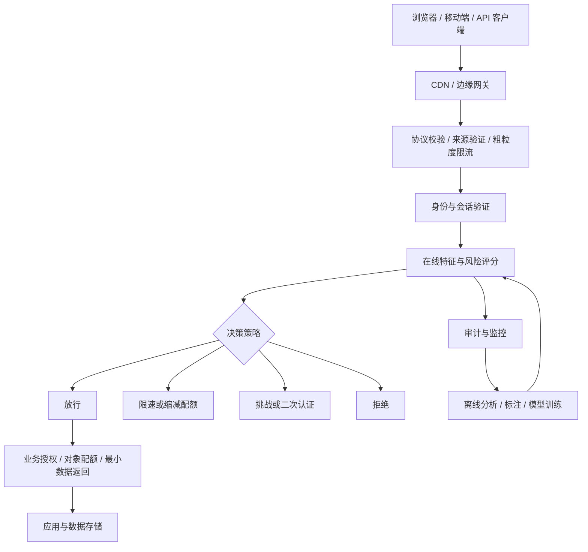

# 反爬算法与工程技术详解

<!-- 本文以网站与 API 的防护设计为主。 -->

整理日期：2026-10-11。面向后端开发、架构师、数据工程师和风控工程师。

> 反爬不是一个单独的算法，而是识别自动化访问、限制资源消耗、保护数据与业务流程的系统。核心目标是在攻击成本、正常用户体验、服务稳定性和维护成本之间取得可度量的平衡。

本文涵盖防护原理、算法、工程实现及授权测试方法。公式和阈值示例用于说明设计，不能直接作为生产默认值；外链为标准、原始论文或官方资料，不代表逐项进行过最新版本验证。

## 目录

1. [问题定义与威胁模型](#1-问题定义与威胁模型)
2. [分层架构与技术全景](#2-分层架构与技术全景)
3. [网络身份与来源识别](#3-网络身份与来源识别)
4. [限流算法与资源配额](#4-限流算法与资源配额)
5. [HTTP、TLS 与浏览器指纹](#5-httptls-与浏览器指纹)
6. [行为统计与访问序列算法](#6-行为统计与访问序列算法)
7. [规则引擎与风险评分](#7-规则引擎与风险评分)
8. [机器学习检测](#8-机器学习检测)
9. [图分析与团伙识别](#9-图分析与团伙识别)
10. [挑战机制与人机验证](#10-挑战机制与人机验证)
11. [签名、令牌与防重放](#11-签名令牌与防重放)
12. [数据层与业务层防护](#12-数据层与业务层防护)
13. [Web、移动端与 API 的差异](#13-web移动端与-api-的差异)
14. [工程实现示例](#14-工程实现示例)
15. [特征平台与在线架构](#15-特征平台与在线架构)
16. [评估、误判与实验](#16-评估误判与实验)
17. [对抗演进与维护](#17-对抗演进与维护)
18. [落地路线与选型](#18-落地路线与选型)
19. [常见误区与排障](#19-常见误区与排障)
20. [术语与参考资料](#20-术语与参考资料)

## 1. 问题定义与威胁模型

### 1.1 需要保护什么

| 目标 | 典型滥用 | 可观测业务指标 |
| --- | --- | --- |
| 服务可用性 | 高频请求、昂贵查询、并发连接占用 | CPU、队列长度、数据库耗时、P99 延迟 |
| 数据资产 | 大规模商品、内容、价格或用户信息采集 | 每主体唯一对象数、数据输出量、覆盖率 |
| 业务公平性 | 抢购、批量预约、库存占用 | 单主体占用量、下单速度、释放率 |
| 账号安全 | 撞库、批量注册、会话盗用 | 登录失败率、账号关联数、异常会话 |
| 内容与交易质量 | 批量发帖、虚假互动、优惠套利 | 重复内容比例、转化异常、损失金额 |

爬虫检测与 DDoS 防护、账号风控有交集，但不等价。低频分布式采集可能不影响带宽却损害数据资产；正常客户端重试风暴可能造成高流量却没有恶意。

### 1.2 按能力区分访问者

- 普通 HTTP 客户端：只请求 HTML 或 JSON，可能不执行 JavaScript。
- 浏览器自动化：能执行脚本、保存 Cookie、加载资源、完成页面交互。
- 分布式采集：跨多个地址、会话和账号访问，单个节点频率较低。
- 账号型自动化：利用已登录身份访问敏感数据或业务流程。
- 合法自动化：搜索引擎、合作方 API、监控、辅助技术、企业批量工具。

应明确：允许哪些主体访问哪些资源、多少次、多久、是否允许批量导出。仅靠“看起来像人”无法替代产品授权和资源配额。

### 1.3 基础限制

公开交付给浏览器的数据，通常不能保证绝对不可复制。客户端代码和静态密钥可被观察；HTTPS 保护传输链路，不能阻止合法客户端读取返回内容。防护设计通常是限制规模、提高成本、减少无授权暴露，并建立可持续的检测闭环。

## 2. 分层架构与技术全景



| 层级 | 技术 | 优点 | 主要局限 |
| --- | --- | --- | --- |
| 网络 | IP/ASN 信誉、来源验证、连接限制 | 低成本、可在边缘执行 | NAT、移动网络、共享代理造成混淆 |
| 协议 | HTTP 头一致性、TLS 指纹 | 无需复杂页面交互 | 浏览器升级、代理和协议变化影响稳定性 |
| 会话 | Cookie 生命周期、账号关系、令牌状态 | 可建立持续观察 | Cookie 丢失、共享设备、登录切换 |
| 行为 | 时间间隔、路径序列、对象覆盖 | 接近业务语义 | 需要上下文，标签存在偏差 |
| 算法 | 规则、统计模型、分类器、图模型 | 可融合多个弱信号 | 成本、解释性、漂移与误判 |
| 挑战 | JavaScript、验证码、二次认证 | 可对高风险流量追加成本 | 用户摩擦与无障碍问题 |
| 数据 | 字段裁剪、授权、导出额度 | 直接减少损失面 | 需要产品和业务配合 |

常见模式是“低成本确定性校验 → 多信号评分 → 只对不确定流量追加挑战 → 业务配额兜底”。不能把昂贵模型或验证码放在所有请求的必经路径。

## 3. 网络身份与来源识别

### 3.1 IP、网段与 ASN

IP 信号包括近期请求速率、失败比例、地址历史信誉、是否属于云机房、关联账号数、地域跳变。ASN 可以提供网络运营主体信息，但“机房网络”不等于恶意，“住宅网络”也不等于可信。

限制：公司出口、学校、运营商 CGNAT 可能让大量正常用户共享地址；IPv6 地址变化不意味着不同设备。按网段聚合必须结合分配方式和实际数据，不能固定套用所有 IPv6 前缀。

### 3.2 正确取得客户端地址

只有来自受信任反向代理的转发头才能作为来源依据。直接信任任意 `X-Forwarded-For` 会让访问者伪造统计键。应配置可信代理范围、约定追加规则、解析整个代理链，并禁止绕过 CDN 直接访问源站。

### 3.3 合法搜索引擎验证

User-Agent 名称不是身份凭据。应按搜索引擎官方说明验证其公布的 IP 范围，或使用要求的反向 DNS 与正向 DNS 双向验证：

1. 反查请求 IP 对应的主机名。
2. 按域名边界验证官方后缀，不能只用字符串包含判断。
3. 正查该主机名，确认返回地址包含原始 IP。
4. 设超时、缓存和后台刷新，避免 DNS 查验拖慢在线请求。

### 3.4 信誉衰减

可以让旧违规贡献随时间衰减：`R(t) = R(t0) × exp(-(t-t0)/τ) + 新事件贡献`。`τ` 是时间尺度。封禁应有 TTL、解除条件和申诉通道；动态地址上的永久封禁容易影响后来获得地址的用户。

## 4. 限流算法与资源配额

限流控制使用量，本身不判断访问是否恶意。正常流量也可能超额，分布式滥用也可能在单节点额度内。

### 4.1 固定窗口

窗口内计数超过 `L` 即拒绝。状态少、实现简单，但相邻窗口边界可能在极短时间内允许接近 `2L` 的请求。必须原子执行计数和首次设置 TTL，避免进程失败留下永久计数键。

### 4.2 滑动窗口日志

保存窗口内请求时间戳；删除早于 `now-W` 的记录，检查剩余数量。精度高，但状态规模约为窗口内请求量；热主体会使存储和排序成本上升。拒绝请求是否写入日志必须明确，否则持续重试可能延长封锁。

### 4.3 滑动窗口计数

按当前窗口位置近似估算：

```text
estimated = current_count + previous_count × (1 - elapsed / window_size)
```

状态较少，但默认前一窗口内请求相对均匀；对集中突发的估计可能偏差较大。要求严格配额时不要把它当成精确日志。

### 4.4 令牌桶

桶容量 `B`，补充速率 `r`，请求成本 `c`：

```text
available = min(B, old_tokens + r × max(0, now - last_time))
allow iff available >= c
new_tokens = available - c if allowed else available
```

满桶允许最多约 `B/c` 次即时请求，持续吞吐约为 `r/c`。突发能力与长期速率独立配置。查询、导出等操作可以按 CPU、行数或字节数设置成本；预估与实际成本存在差异时，需要预留后结算机制。

### 4.5 漏桶与 GCRA

漏桶通常强调以固定速率排出请求：若采用队列形式，需要限制队列长度和等待时间，避免保护服务却堆积海量排队请求。

GCRA 用理论到达时间 TAT 表示发送计划。对每次请求：若 `now < TAT - tolerance` 则拒绝；否则更新 `TAT = max(now, TAT) + interval`。`interval` 是单次请求的理论间隔，`tolerance` 决定突发容忍度。状态很少，但应统一库中 burst 参数与容忍时间的换算约定。

### 4.6 并发限制

QPS 低并不保证资源占用低。慢查询、长连接和导出需要独立并发上限、超时、排队预算。分布式并发槽位应使用带租约的持有记录或等效机制，处理进程崩溃和重复释放；单纯 `INCR/DECR` 容易永久泄漏槽位。

### 4.7 多维配额

- IP：保护匿名入口，阈值应考虑共享出口。
- 账号/API Key：限制明确主体的长期使用量。
- 会话：限制短期自动化与异常重试。
- 资源对象：避免集中消耗单个商品、帖子或活动。
- 全局：保护数据库、付费上游和服务容量。
- 租户：防止一个租户挤占其他租户资源。

多维检查应说明扣费语义：若先扣账号桶、后被全局桶拒绝，是否返还？跨分片无法轻易实现全部原子成功，可选择预留/结算、局部原子组合，或明确拒绝仍计入尝试额度。

### 4.8 分布式与响应

同一 Redis 分片内可用 Lua 保证检查和更新原子性；Cluster 多键脚本要求相关键在同一槽，不能以牺牲全部负载分布来简单集中所有键。跨机房精确全局限额需要协调，常用中心额度分配到区域、区域内严格执行的方案，并明确最大超发量。

额度耗尽通常返回 `429 Too Many Requests`，必要时提供 `Retry-After`；授权拒绝通常用 `403`，服务过载可能用 `503`。客户端重试应指数退避并加入随机抖动。外部响应无需暴露内部检测规则。

## 5. HTTP、TLS 与浏览器指纹

### 5.1 HTTP 信号

可观察方法、头字段组合、Accept 类型、语言、Cookie 使用、Fetch Metadata、请求来源上下文和资源加载关联。检测重点是与客户端声明、页面流程是否一致。

HTTP 头顺序、大小写并非稳定身份：HTTP/2、HTTP/3 的传输方式和代理转换会改变观测。Referer 可能被隐私策略删除；Origin 并非所有请求都有。不能据此单独封禁。CORS 限制浏览器读取跨源响应，不阻止非浏览器直接发请求。

### 5.2 TLS 指纹与 JA3/JA4

JA3 从 TLS ClientHello 中的版本、密码套件、扩展等构造表示并生成指纹；JA4 系列采用不同规范组织连接及协议特征。指纹可帮助聚合客户端栈，但不是设备身份证：大量客户端可能共享指纹，同一客户端也可能因升级变化。

TLS 信号通常应在实际终止客户端 TLS 的边缘采集。应用服务器若只看到 CDN 到源站的连接，记录的是 CDN 的指纹。浏览器对扩展顺序的随机化等演进会影响历史特征；HTTP/3、QUIC 应单独评估可观测字段。遵循具体实现规范，不把 JA3 与 JA4 当成可直接互换的哈希。

### 5.3 浏览器环境信号

| 信号 | 可以说明什么 | 常见误判来源 |
| --- | --- | --- |
| UA 与 Client Hints | 声明的软件平台信息 | UA 缩减、隐私设置、代理改写 |
| 屏幕、语言、时区 | 环境组合与历史变化 | 外接屏幕、出差、多语言用户 |
| Canvas/WebGL | 渲染能力与输出差异 | 驱动升级、隐私保护、虚拟桌面 |
| 字体与音频特征 | 环境差异 | 系统升级、权限和兼容性 |
| 自动化相关属性 | 可能的自动化环境 | 合法测试、辅助工具、浏览器变化 |
| 脚本执行与存储能力 | 客户端能力与状态连续性 | 禁用脚本、存储清理、WebView 限制 |

客户端遥测可被修改、重放或缺失。应标注来源可信度，使用多个独立维度交叉验证；“没有遥测”与“恶意”必须分开编码。

### 5.4 稳定性与隐私

指纹高熵不等于可靠：跨用户可分辨性、同用户稳定性、伪造成本是不同维度。采集前应评估必要性、保留时间、访问权限和地区要求；对标识做 HMAC 或哈希仍可能属于可关联的个人数据，不能因此宣称匿名化。

## 6. 行为统计与访问序列算法

### 6.1 请求速率与时间间隔

设到达时间为 `t1,...,tn`，间隔 `Δi=ti-ti-1`。可计算平均、标准差、分位数、变异系数：`CV = std(Δ) / mean(Δ)`。

过于规律的间隔、长期无休止访问、突发并发等可以构成弱信号，但不能把“低 CV”作为单一判断：定时监控、轮询页面也很规律，批处理客户端也可能合法。按 endpoint 和客户端类别建立基线。

### 6.2 EWMA 与稳健异常分数

指数加权移动平均：`m_t = αx_t + (1-α)m_(t-1)`。较大 α 反应快，较小 α 更平滑。应区分请求到来触发更新与固定周期更新，不规则时间可用时间相关衰减。

普通 Z-score：`z=(x-μ)/σ` 对长尾和极端值敏感。可使用中位数与 MAD：`robust_z = 0.6745 × (x-median) / MAD`；MAD 为零时需要下限或回退策略。不要让近期攻击流量立即污染正常基线。

### 6.3 路径分布与熵

路径类别概率为 `p_i`，熵 `H=-Σ p_i log2(p_i)`。低熵可能表示重复轮询，高熵可能表示广泛枚举；两者都可能正常。熵必须结合样本数、业务场景、路径类别数解释，小样本不宜直接评分。

路径先规范化，如 `/product/123` 转为 `/product/{id}`，同时保留对象 ID 的聚合统计。否则既有高基数问题，又可能混淆页面类型与对象覆盖。

### 6.4 对象覆盖与遍历

常用特征：窗口内唯一对象数、详情/列表请求比、顺序 ID 比例、分页推进速度、重复访问比例、跨分类覆盖率、单位时间返回字节数、访问后收藏/购买等业务行为比例。

对象 ID 连续不一定异常，正常页面排序也可能连续。业务行为缺失也不能直接判恶意，因为用户可能只浏览或比较价格。

### 6.5 马尔可夫与状态机

可把页面类型作为状态，估计正常转移概率 `P(next|current)`。序列异常分数可写为：

```text
score = -1 / (n - 1) × Σ log(P(state[i+1] | state[i]) + epsilon)
```

通过加法平滑或回退模型处理新转移。直达链接、浏览器后退、多标签页、缓存、SPA 和深链会影响顺序；按会话简单串联所有请求可能构造不存在的流程。对购买、预约等明确流程可使用服务端状态机验证业务前置条件。

### 6.6 交互行为

鼠标速度、加速度、轨迹曲率、停留时长、滚动与页面可见性可辅助分析。DTW 可比较不同长度的时间序列，但距离不是“人类概率”，且计算和模板维护成本较高。

移动端、键盘导航、屏幕阅读器和自动填表可能没有预期鼠标行为。只采集完成检测所需的特征，避免记录输入内容或形成不必要的细粒度用户画像。

## 7. 规则引擎与风险评分

### 7.1 规则类型

- 确定性规则：签名错误、令牌过期、无权限访问、明确超出额度。
- 组合规则：短期高覆盖 + 大量新会话 + 同一资源重复访问。
- 趋势规则：相对历史基线突增、风险账号比例上升。
- 例外策略：经验证搜索引擎、合作方身份、内部监控的独立配额。

合法例外应有身份校验和额度，不能成为无限流量的永久白名单。

### 7.2 线性与概率评分

线性分数：`s=b+Σw_i f_i`。若采用逻辑回归，`p=1/(1+exp(-s))`。没有经过校准的数据支持时，手工加权分数不能被解释为真实恶意概率。

高度相关的信号会重复计分，例如机房 IP、特定 TLS 栈和脚本客户端特征可能描述同一属性。可以按来源分组、限制单组贡献、建立交互项，或使用学习模型并检验校准。

### 7.3 风险到动作

| 风险与证据 | 可能动作 | 设计要点 |
| --- | --- | --- |
| 低风险、额度充足 | 放行 | 留低成本观测 |
| 用量过高但证据不足 | 限速、缩减页大小 | 不把超额直接记为恶意 |
| 多信号中风险 | 可访问挑战、短期观察 | 给正常用户恢复路径 |
| 明确权限或签名失败 | 拒绝该操作 | 遵循认证授权语义 |
| 高风险且证据充分 | 短期封禁、账号调查 | 记录理由、期限与影响 |

用阈值滞回避免状态来回跳变，例如升级需要达到更高阈值，解除需要低于更低阈值并持续一段时间。所有示例阈值都应由业务成本与验证数据决定。

### 7.4 策略治理

每个决策记录策略版本、模型版本、特征时间、命中理由、动作、TTL 和 request ID。规则支持影子运行、灰度、快速停用和回滚。高风险动作应有明确负责人，临时规则要有过期机制。

## 8. 机器学习检测

### 8.1 监督学习

| 方法 | 适合用途 | 主要注意点 |
| --- | --- | --- |
| 逻辑回归 | 可解释基线、低延迟评分 | 非线性能力有限，处理尺度和交互 |
| 随机森林 | 非线性表格特征 | 模型大小、推理成本、概率校准 |
| GBDT/LightGBM/XGBoost | 多源统计特征分类 | 泄漏、漂移、类别不平衡 |
| RNN/Transformer | 长序列上下文 | 标签与数据量、延迟、复杂度 |
| 图模型 | 多主体协同识别 | 图构建偏差、在线更新成本 |

优先建立可解释基线。复杂模型只有在实际业务指标上稳定改善时才值得上线。

### 8.2 标签与偏差

标签来源包括人工审核、确认违规账号、业务损失事件、挑战结果、授权压测。验证码失败不等于恶意，成功也不等于正常；已封禁流量没有后续行为，会产生选择偏差。

可分为“确认恶意、确认正常、未知”，未知不应自动归为负类。弱监督、半监督和正例未标注学习可减少部分问题，但依然需要独立审核样本。

### 8.3 无监督与变化检测

- Isolation Forest：适合发现表格特征中的孤立样本，不直接提供恶意概率。
- LOF：比较局部密度，对尺度和邻域选择敏感。
- One-Class SVM：适合相对稳定的正常分布，大规模训练可能昂贵。
- 聚类：发现行为群体，但异常簇也可能是新产品或合法客户端。
- 自编码器：通过重建误差发现偏离，需避免训练集被攻击污染。
- CUSUM/变化点检测：识别流量或特征分布的结构变化。

输出通常用于排序、调查或辅助评分。异常和恶意是不同概念。

### 8.4 数据切分与泄漏

按时间切分训练和测试，必要时进一步按账号、设备或攻击活动分组，防止同一团伙出现在两侧导致虚高结果。特征只能使用决策时已发生的事件；不能使用之后的封禁结果、完整会话长度等未来信息。

对窗口末尾样本考虑延迟标签和观察期。训练中负采样或类权重改变了分布，模型分数若用于概率决策，需在有代表性的样本上校准。

### 8.5 概率校准与解释

可用可靠性曲线、Brier score、分群校准误差衡量预测概率；Platt scaling 或 isotonic regression 可做校准。SHAP 等解释表示模型贡献，不能自动当作因果证据。上线应监控缺失率、特征分布、分群表现和模型覆盖率。

## 9. 图分析与团伙识别

节点可包括账号、会话、IP、设备标识、API Key、业务对象；边表示在一定时间内使用、共享或访问关系。

可计算：每设备关联账号数、每账号使用地址数、共享对象集合相似度、访问时间同步性、密集子图和社区结构。Jaccard 相似度为 `|A∩B|/|A∪B|`；大量集合可用 MinHash/LSH 生成候选，再精确复核。

共享公司出口或公共终端会产生高连接度正常节点。应对公共枢纽降权、按时间限制边、区分证据强弱，并避免“与一个违规账号相连就封禁整个连通分量”。

图分析适合离线发现协同活动，结果可形成带 TTL 的团伙信号供在线系统使用。若采用 GNN，应评估新节点、关系缺失和攻击者污染图的影响。

## 10. 挑战机制与人机验证

### 10.1 JavaScript 挑战

服务端签发短期随机挑战，客户端执行任务或回传环境信号，服务端核验并签发短期通行状态。能区分部分简单客户端，但现代浏览器自动化也能执行脚本。

通行状态应绑定会话或操作范围、设置有效期、避免在共享 CDN 缓存中跨用户泄漏。不要把挑战通过等同于长期可信。

### 10.2 验证码

验证码提供额外信号和摩擦，不能保证访问者是真人或目的合法。完整链路包括挑战签发、上下文绑定、服务端结果验证、短期有效、一用即失效、重试限制和异常监控。

不能只在前端判断通过；浏览器提交一个 `passed=true` 没有可信度。图片、声音和行为式验证都要评估无障碍、语言、弱网与隐私。优先对风险流量使用，并提供等效恢复方式。

### 10.3 工作量证明 PoW

典型哈希任务要求找到 nonce，使 `hash(challenge || nonce)` 满足某难度。理想均匀哈希下，要求前 `d` 位为零，期望尝试次数约 `2^d`；验证只需一次哈希。

应绑定签发时间、会话与用途、防止预计算和重放，限制挑战签发频率。不同设备性能差异巨大，CPU PoW 可伤害移动端体验，硬件加速也改变攻击成本。内存困难任务同样需要测量验证成本和设备负担。

### 10.4 二次认证与可信设备

高价值操作可要求重新登录、邮件确认或 WebAuthn 等强认证。认证提升主体可信度，不自动授予无限访问；已登录用户仍需权限和业务额度。挑战服务异常时，应按操作风险设计明确降级路径。

## 11. 签名、令牌与防重放

### 11.1 签名的作用边界

签名校验请求内容或凭据是否被篡改；不能单独证明访问者是人，也不能识别持有合法凭据的批量访问。服务端 API 密钥可以是秘密，发布到浏览器 JavaScript 的固定密钥通常不能长期保密。

常见构造：`HMAC-SHA256(secret, canonical_request)`。必须定义方法、目标 URI、查询、请求体摘要、时间和 nonce 的编码与规范化方式；字段之间使用明确分隔或长度编码，避免拼接歧义。

### 11.2 签名请求的必要检查

1. 限制请求体大小并明确编码，避免摘要验证成为资源消耗点。
2. 根据受控 key ID 选择密钥，支持轮换和过渡期。
3. 检查时间戳格式、过期时间和允许时钟偏差。
4. 按约定生成签名材料；签名用常数时间比较。
5. 在签名有效后原子登记 nonce，拒绝重复使用。
6. 校验身份、权限、额度和业务幂等性。

验签前就无条件存储 nonce 可能让无效请求污染存储。过期窗口与 nonce TTL 必须配套：TTL 至少覆盖该请求剩余可接受期，并考虑允许的未来时钟偏差。

### 11.3 nonce、防重放与幂等

nonce 应由安全随机源生成，服务端以 `(身份, nonce)` 原子去重，并设置有界 TTL。时间戳只限制重放时长，不能阻止窗口内重放。

防重放拒绝重复提交；幂等键用于合法重试返回同一结果。二者目的不同。付款、下单等操作应把幂等键绑定身份、请求内容摘要与结果，防止相同键被用于不同请求。

### 11.4 JWT 与签名 URL

JWT 通常是签名而非加密，载荷可能被读取。验证固定允许的算法、issuer、audience、expiry 和用途，必要时维护撤销状态。使用签名 URL 时限制资源、路径、方法、有效期，并避免令牌出现在日志和 Referer 中。

IP 强绑定可因移动网络切换误伤用户；绑定会话、身份或资源范围往往更可控。高价值操作需要支持撤销和密钥轮换，不能仅依赖长期有效的无状态令牌。

### 11.5 CSRF 与反爬的关系

CSRF Token、SameSite Cookie 和 Origin 校验保护跨站请求语境，不是通用机器人识别。自动化客户端可以建立自己的会话并取得有效 CSRF Token。认证、授权、CSRF、防重放和限流要分别设计。

## 12. 数据层与业务层防护

### 12.1 最小数据返回

敏感字段不要放在初始 HTML、隐藏 DOM、客户端状态或通用 JSON 中。隐藏样式只影响显示。按权限裁剪字段，在服务端执行对象级授权，避免用“知道 ID”代替有权读取。

### 12.2 查询和导出预算

限制分页大小、排序范围、过滤复杂度、聚合维度、总结果数、唯一对象访问量和每日导出字节数。GraphQL 可建立深度、节点数和成本预算；单次请求包含大量对象时，仅按请求次数限流不足。

游标分页提升一致性和部分查询性能，但并不自动防采集。公开可翻页数据依然能被持续读取。批量导出最好走可审计的授权通道，以明确额度替代对正常用户的随机阻断。

### 12.3 数据变换与水印

字体映射、DOM 分段、图片化、前端解码等会增加某些简单采集成本，但不能构成授权边界，并可能损害 SEO、可访问性、复制体验和性能。

水印或主体特定标记可用于泄漏追踪，应评估误归因、碰撞、可移除性和对数据真实性的影响。不要向正常业务返回不易发现的错误价格、权限或交易信息。

### 12.4 蜜罐与诱饵

可在隔离测试或受控页面设置正常流程不会调用的端点，观察异常访问。预取、扫描器、辅助工具可能触发诱饵，因此只能作为组合信号。不要创建可索引的危险动作，也不要把隐藏链接访问直接作为永久封禁依据。

### 12.5 robots.txt

`robots.txt` 是合作式抓取协议，不是认证授权或访问控制；不要在其中披露需要保密的路径。对合法爬虫合理声明规则，对需要保密的资源使用服务端权限。

## 13. Web、移动端与 API 的差异

| 场景 | 推荐重点 | 不能依赖的假设 |
| --- | --- | --- |
| 公开网页 | CDN、会话、行为、SEO 兼容 | 所有正常用户都运行完整脚本 |
| 登录 Web | 对象授权、账号配额、会话风控 | 登录后就不会批量采集 |
| 移动 App | 服务端配额、应用完整性信号、版本治理 | 安装包内固定密钥不可提取 |
| 合作方 API | 独立凭据、租户额度、审计、撤销 | API Key 持有者始终合理使用 |
| 管理后台 | 强认证、最小权限、导出审计 | 内部地址天然可信 |
| WebSocket/SSE | 连接额度、消息速率、订阅范围 | 握手时限流已覆盖后续消息 |

移动端可使用平台提供的应用完整性或设备证明能力，但其证明范围、重放保护、支持设备和失败行为需要按官方协议实现。它们是风控输入，不能代替服务端授权。

API 应返回机器可理解的错误与重试提示，避免把 HTML 验证码插入 JSON 协议。对受控合作方，优先使用明确身份与额度，而不是浏览器指纹。

## 14. 工程实现示例

### 14.1 Python 单进程令牌桶

下面用于演示令牌桶及 retry-after 计算。它不是完整网关：未包含分布式状态、键清理、可信身份解析或 HTTP 适配；生产不能直接使用无界主体映射。

```python
import math
import threading
import time

class TokenBucket:
    def __init__(self, capacity: float, refill_rate: float):
        if not (math.isfinite(capacity) and capacity > 0):
            raise ValueError("capacity must be finite and positive")
        if not (math.isfinite(refill_rate) and refill_rate > 0):
            raise ValueError("refill_rate must be finite and positive")
        self.capacity = capacity
        self.rate = refill_rate
        self.tokens = capacity
        self.updated_at = time.monotonic()
        self.lock = threading.Lock()

    def acquire(self, cost: float = 1.0) -> tuple[bool, float]:
        if not (math.isfinite(cost) and 0 < cost <= self.capacity):
            raise ValueError("cost must be positive and fit the bucket")
        with self.lock:
            now = time.monotonic()
            elapsed = max(0.0, now - self.updated_at)
            self.tokens = min(self.capacity, self.tokens + elapsed * self.rate)
            self.updated_at = now
            if self.tokens >= cost:
                self.tokens -= cost
                return True, 0.0
            wait_seconds = (cost - self.tokens) / self.rate
            return False, wait_seconds
```

单机时间差使用单调时钟，避免系统校时造成负间隔。多个进程各自持有桶会将总额度放大；必须明确实例级额度与主体级全局额度的关系。

### 14.2 Redis 原子令牌桶伪代码

```text
输入：主体键、桶容量 B、补充速率 r、成本 c
在同一个原子操作中：
  获取服务端统一时间
  读取 tokens 和 last_time；不存在时初始化满桶
  effective_time = max(now, last_time)
  tokens = min(B, tokens + (effective_time-last_time) * r)
  若 tokens >= c：扣除 c，允许
  否则：拒绝，计算需要等待的时间
  保存 tokens 与 effective_time
  设置 TTL >= ceil(B/r) + 合理余量
返回允许状态与等待时间
```

TTL 至少覆盖从空桶恢复为满桶所需时间，避免提前删除状态让访问者重新获得满桶。实际 Lua 脚本需校验数值、成本、毫秒单位和脚本兼容性；Redis 时间并非严格单调，应对时间回拨保留不倒退的状态时间。考虑故障转移丢失近期写入可能导致的额度超发。

### 14.3 HMAC 请求签名示例

本例是自定义协议教学示例；跨组织集成优先采用有明确规范的方案，例如 HTTP Message Signatures。密钥只应存在于受控服务端客户端及服务端，浏览器不能靠固定内置密钥建立可信身份。

```python
import hashlib
import hmac
import json

# target_uri 必须由发送方和接收方按同一协议构造。
# 若代理改写 host/path，要预先定义实际签名的外部目标。
def signature(secret: bytes, method: str, target_uri: str,
              timestamp: int, nonce: str, body: bytes) -> str:
    body_hash = hashlib.sha256(body).hexdigest()
    fields = [method.upper(), target_uri, timestamp, nonce, body_hash]
    message = json.dumps(fields, ensure_ascii=True,
                         separators=(",", ":")).encode("utf-8")
    return hmac.new(secret, message, hashlib.sha256).hexdigest()

def verify_signature(secret: bytes, method: str, target_uri: str,
                     timestamp: int, nonce: str, body: bytes,
                     supplied: str) -> bool:
    if len(supplied) != 64:
        return False
    try:
        bytes.fromhex(supplied)
    except ValueError:
        return False
    expected = signature(secret, method, target_uri, timestamp, nonce, body)
    return hmac.compare_digest(expected, supplied.lower())
```

这段代码只校验摘要签名；调用方仍必须验证时间窗口、原子消费 nonce、密钥身份、权限与额度。比较和规范化规则要在双方协议中固定，不能静默改变路径编码或忽略重复查询参数。

### 14.4 风险决策伪代码

```text
先验证协议格式、请求大小、身份和权限
若确定性验证失败：按相应协议拒绝
检查全局容量与主体额度
构造决策时可用特征，标记缺失来源与版本
执行已校准的模型或规则评分
低风险：放行
中风险：选择该客户端可完成的挑战或限制额度
高风险：按证据采取带期限的限制
记录决策与业务结果，进入审核反馈
```

不要用“模型认为正常”覆盖硬性权限失败，也不要对明显无权限请求追加昂贵的人机验证。

## 15. 特征平台与在线架构

### 15.1 数据与特征契约

事件字段建议包括：服务端时间、request ID、路由模板、可信来源地址的受控标识、主体/租户、状态码、耗时、返回字节数、对象类别、决策及版本。避免记录完整 Cookie、Authorization、签名密钥、验证码答案和不必要的敏感正文。

每个特征定义聚合键、时间窗口、去重逻辑、更新时间、单位、缺失值、有效期和数据来源。客户端上报时间不应直接替代服务端事件时间；流处理应考虑乱序、重复消息和水位线。

### 15.2 高频统计的数据结构

| 结构 | 用途 | 局限 |
| --- | --- | --- |
| 哈希表/计数器 | 精确计数、短窗口状态 | 高基数键导致内存增长 |
| HyperLogLog | 估计唯一对象或主体数 | 有估计误差，通常不支持任意精确删除 |
| Count-Min Sketch | 近似频率、热点检测 | 碰撞可高估，不能直接用于精确扣费 |
| Bloom Filter | 近似成员判断 | 有误报，普通形式不支持删除 |
| Cuckoo Filter | 近似成员判断与删除 | 仍有误报与容量限制 |
| t-digest | 分位数近似 | 精度受实现和分布影响 |
| MinHash | 集合相似度候选 | 是估计，需复核关键决策 |

不能用有误报的过滤器作为高价值操作唯一的 nonce 去重依据，否则正常请求可能被误认为重放。资源配额的精确扣费和分析统计应区分。

### 15.3 延迟预算与降级

请求总耗时应拆分为边缘检查、特征读取、模型推理、业务执行。低成本信号同步使用，昂贵图分析和 DNS 查询尽量异步。

对于风控组件故障：低风险公开内容可以在独立容量限制下保守放行；高价值写操作可以保留认证授权和明确额度、转人工或拒绝。不能用统一 fail-open/fail-closed 处理所有接口。超时、断路器、缓存失效、模型缺失都应有可观察行为。

### 15.4 缓存与边缘一致性

缓存风险结果必须包含主体、资源用途、策略版本和 TTL；必要时支持紧急撤销。私有内容和挑战结果不能用不完整 cache key 缓存。边缘与源站分别限流时要定义额度关系，防止重复扣费或规则不一致。

## 16. 评估、误判与实验

### 16.1 混淆矩阵

设恶意为正类：TP 是正确拦截恶意，FP 是误伤正常，FN 是漏过恶意，TN 是正确放行正常。

```text
Precision = TP / (TP + FP)
Recall    = TP / (TP + FN)
FPR       = FP / (FP + TN)
F1        = 2 × Precision × Recall / (Precision + Recall)
```

需要明确统计单位是请求、会话、账号还是攻击活动。一个团伙制造百万请求会让请求级结果看起来很好，却掩盖大量正常账号被误伤。

### 16.2 基础率影响

假设 100 万请求中恶意占 1%，召回率 90%，正常请求误报率 1%：TP=9000，FP=9900，拦截精确率约 47.6%。看似很小的误报率，在正常流量占绝大多数时仍会造成严重问题。

不平衡场景中准确率和 ROC-AUC 往往不足，需关注 PR-AUC、固定可接受误伤率下的召回率、校准，以及真实业务损失。

### 16.3 业务指标

- 正常用户挑战率、完成率、额外等待时间与放弃率。
- 数据异常覆盖、恶意成功读取对象数与字节数。
- 每个被保护操作的资源成本及上游费用。
- 攻击发现时间、策略响应时间、解除时间。
- 分浏览器、地区、网络、客户端、无障碍方式的误伤率。
- 被限制账号比例、申诉成功率和恢复时间。

“拦截量增加”不是单独的成功指标；可能只是新策略误伤更多人。

### 16.4 阈值与成本决策

可以定义 `expected_cost = C_FP×FP + C_FN×FN + 挑战摩擦成本 + 推理成本`。对二元判定，若 p 是校准的恶意概率，且只有误拦与漏放两类成本，选择拦截的条件可推得 `p > C_FP/(C_FP+C_FN)`；现实还有挑战、延迟和资源损失，需要多动作成本矩阵。

不同接口的漏放损失不同，登录、内容读取、批量导出和支付操作不应共享一套阈值。

### 16.5 实验流程

1. 离线按时间与主体分组验证，审核代表性样本。
2. 影子模式只计算决策，比较现有策略与新策略。
3. 对稳定主体分桶灰度，监控挑战率、转化和资源消耗。
4. 设置预先定义的停止条件和回滚方式。
5. 分析正常用户影响与攻击活动变化，避免只看总量。

攻击者可能跨实验组活动，实验组间不完全独立。不能为了获取对照数据故意放开关键授权；对照策略依然应满足安全与容量底线。

### 16.6 授权测试清单

在自有或明确授权的环境验证：窗口边界、并发原子性、时间回拨、Redis 故障、代理头伪造、合法客户端重试、Cookie 丢失、共享出口、浏览器升级、弱网与辅助技术。签名测试覆盖修改请求体、重复 nonce、过期时间、未来时间、密钥轮换、重复查询参数和路径编码差异。

## 17. 对抗演进与维护

| 能力变化 | 防护启示 |
| --- | --- |
| 客户端可运行完整浏览器 | 脚本执行能力不能单独区分真人 |
| 请求分散到多个来源 | 增加账号、对象覆盖、图关联与全局预算 |
| 使用合法账号和令牌 | 保留主体配额与业务流程控制 |
| 行为节奏更接近正常 | 关注长期产出、对象覆盖和业务价值 |
| 浏览器与协议持续升级 | 指纹特征版本化，监控正常分布漂移 |
| 更强的隐私保护 | 降低高熵指纹依赖，强化明确身份与额度 |

维护应围绕业务结果和检测稳定性，而不是不断增加脆弱的单字段规则。变更前检查策略是否把合法新客户端误识别为攻击；保留审核样本、过期标签和退役规则记录。

可以监测 PSI、JS 散度、缺失率或分位数变化作为漂移提示，但这些数值本身不证明模型失效或攻击发生。结合分群表现、人工审核和业务指标决定是否重训。

## 18. 落地路线与选型

### 18.1 最小可用方案

先明确公开与敏感资源，做好服务端授权、源站保护、请求大小限制、可信地址解析、账号/IP/接口限流、超时和日志。若这些缺失，优先投入基础治理，而不是复杂指纹或深度学习。

### 18.2 中等规模

建立多时间窗口统计、风险规则、对象覆盖配额、按客户端区分的挑战、影子发布、误判反馈和密钥轮换。增加租户配额和昂贵接口成本预算。

### 18.3 高价值或大规模

再考虑流式特征平台、经过验证的分类模型、离线图分析、区域额度分配、精细审核、独立合作方 API 和全链路成本评估。部署复杂度必须由减少的实际损失证明。

### 18.4 自建与托管

| 方案 | 适合情况 | 需要验证 |
| --- | --- | --- |
| CDN/WAF/Bot 托管 | 快速获得边缘容量和通用检测 | 数据处理、误伤恢复、费用、SEO、源站绕过 |
| 网关限流组件 | 明确接口与主体预算 | 原子性、分布式一致性、故障行为 |
| 自建规则平台 | 业务语义强、需要可解释策略 | 维护责任、特征质量、灰度回滚 |
| 自建 ML/图平台 | 规模大、数据与审核能力成熟 | 标签、收益、漂移、推理与存储成本 |

上线前明确：谁维护策略、谁看误判、谁处理故障、多久响应、如何回滚。没有这些运营机制，再好的算法也难以长期有效。

## 19. 常见误区与排障

| 现象或说法 | 问题 | 改进方向 |
| --- | --- | --- |
| “封掉机房 IP 就够了” | 误伤合法自动化，遗漏其他来源 | 多信号与主体配额 |
| “UA 是浏览器所以可信” | 客户端声明不是身份 | 协议与会话一致性，业务行为 |
| “有验证码就无法采集” | 通过不证明用途合法 | 短期挑战状态、长期业务额度 |
| “加密接口参数就是反爬” | 客户端能构造参数时仍可批量请求 | 服务端授权、防重放、限额 |
| “CORS 能防第三方抓取” | 仅约束浏览器跨源读取 | 正确认证授权与配额 |
| “签名能防全部重放” | 同一签名请求仍可再次发送 | 时间窗口 + 原子 nonce 去重 |
| “准确率 99% 就很好” | 类别不平衡可能掩盖严重误伤 | PR、分群指标、业务成本 |
| “模型异常分就是恶意概率” | 未校准，异常不一定恶意 | 人工审核、校准、组合策略 |
| “哈希指纹就没有隐私问题” | 仍可关联个体 | 数据最小化与保留控制 |

常见排障顺序：

1. 限流几乎无效：检查键是否每次变化、多个实例是否各自计数、是否存在源站绕过。
2. 所有用户共享额度：检查取到的是代理 IP，或匿名主体误用同一个固定键。
3. 正常请求突然大量失败：检查时钟、密钥轮换、规范化版本、TTL、缓存及新浏览器分布。
4. 挑战循环：检查 Cookie 属性、域名、SameSite、缓存、第三方存储限制和状态绑定。
5. Redis 内存持续增长：检查高基数键、TTL、窗口清理、拒绝事件记录策略和清理作业。
6. 离线指标好、上线差：检查未来信息泄漏、主体重叠、训练/在线特征差异和基础率变化。
7. 拦截增多、损失不降：检查统计单位、低价值流量占比、未保护接口和业务额度缺口。

## 20. 术语与参考资料

### 20.1 术语

| 术语 | 含义 |
| --- | --- |
| Bot Management | 自动化访问管理，不等同于仅禁止所有机器人 |
| Rate Limiting | 限定时间与主体范围内的使用量 |
| Fingerprint | 客户端或连接特征表示，不保证唯一或不可伪造 |
| Replay | 重复提交曾经有效的请求或凭据 |
| Nonce | 用于新鲜性或去重的随机值或唯一值 |
| Idempotency | 相同操作重试不会产生额外业务副作用 |
| FPR | 正常样本被误判为恶意的比例 |
| Concept Drift | 输入与目标关系随时间变化 |
| Shadow Mode | 计算新策略结果但暂不执行其动作 |
| Fail-open / Fail-closed | 检测组件故障时允许或拒绝，需按场景定义 |

### 20.2 标准与官方资料

- [RFC 9309：Robots Exclusion Protocol](https://www.rfc-editor.org/rfc/rfc9309)：robots.txt 协议与边界。
- [RFC 6585：Additional HTTP Status Codes](https://www.rfc-editor.org/rfc/rfc6585)：包含 429 状态码。
- [RFC 9110：HTTP Semantics](https://www.rfc-editor.org/rfc/rfc9110)：HTTP 方法、状态及 Retry-After 等语义。
- [RFC 2104：HMAC](https://www.rfc-editor.org/rfc/rfc2104)：消息认证码构造。
- [RFC 9421：HTTP Message Signatures](https://www.rfc-editor.org/rfc/rfc9421)：HTTP 消息签名规范。
- [RFC 7519：JSON Web Token](https://www.rfc-editor.org/rfc/rfc7519) 与 [RFC 8725：JWT Best Current Practices](https://www.rfc-editor.org/rfc/rfc8725)：令牌与安全实践。
- [OWASP Automated Threats](https://owasp.org/www-project-automated-threats-to-web-applications/)：自动化业务威胁分类。
- [OWASP API Security](https://owasp.org/www-project-api-security/)：对象授权、资源消耗等 API 风险。
- [OWASP Cheat Sheet Series](https://cheatsheetseries.owasp.org/)：认证、会话、CSRF 等工程建议。
- [Google：验证 Googlebot](https://developers.google.com/search/docs/crawling-indexing/verifying-googlebot)：搜索引擎身份验证。
- [JA3 原始项目](https://github.com/salesforce/ja3)：TLS 指纹方法与实现资料。
- [JA4 项目](https://github.com/FoxIO-LLC/ja4)：JA4 系列规范、实现与许可说明。
- [Redis：Lua scripting](https://redis.io/docs/latest/develop/programmability/eval-intro/)：原子脚本及运行约束。
- [W3C WebAuthn](https://www.w3.org/TR/webauthn-3/)：公钥凭据认证。
- [W3C：Inaccessibility of CAPTCHA](https://www.w3.org/TR/turingtest/)：验证码可访问性问题。

### 20.3 算法资料

- [scikit-learn：Novelty and Outlier Detection](https://scikit-learn.org/stable/modules/outlier_detection.html)：异常检测方法与区别。
- [scikit-learn：Probability calibration](https://scikit-learn.org/stable/modules/calibration.html)：概率校准与可靠性曲线。
- [Isolation Forest 原始论文 DOI](https://doi.org/10.1109/ICDM.2008.17)：随机隔离异常检测。
- [Count-Min Sketch 原始论文 DOI](https://doi.org/10.1016/j.jalgor.2003.12.001)：近似频率统计。
- [HyperLogLog 原始论文](https://algo.inria.fr/flajolet/Publications/FlFuGaMe07.pdf)：近似基数统计。

### 20.4 建议学习顺序

HTTP/代理与认证授权 → 限流与并发控制 → 会话与签名防重放 → 业务特征与统计分析 → 规则引擎和评估 → 监督学习与校准 → 图关联与大规模特征工程。

持续维护时，应为新增内容记录适用客户端、实际效果、误判来源、可复现实验和资料来源，避免把短期有效的特征写成永久结论。
